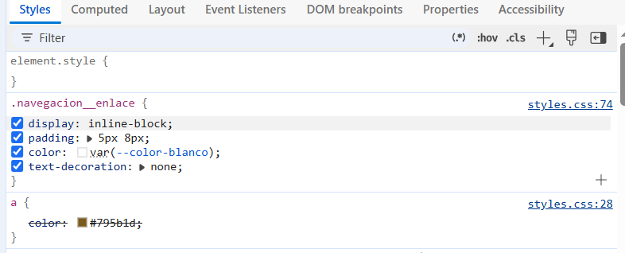
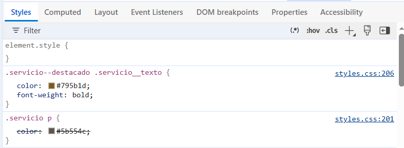
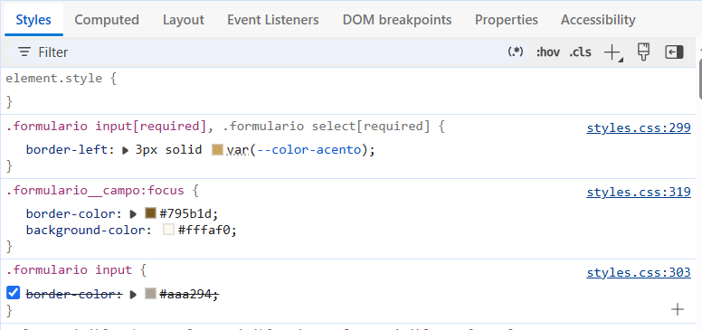
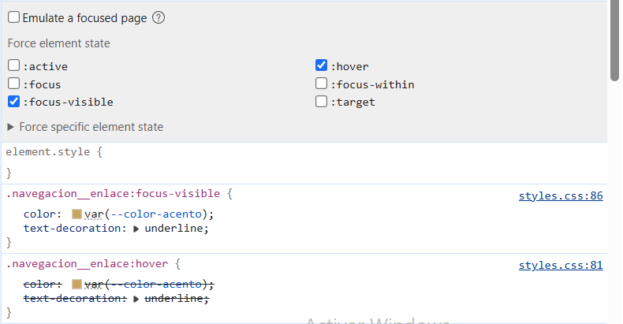
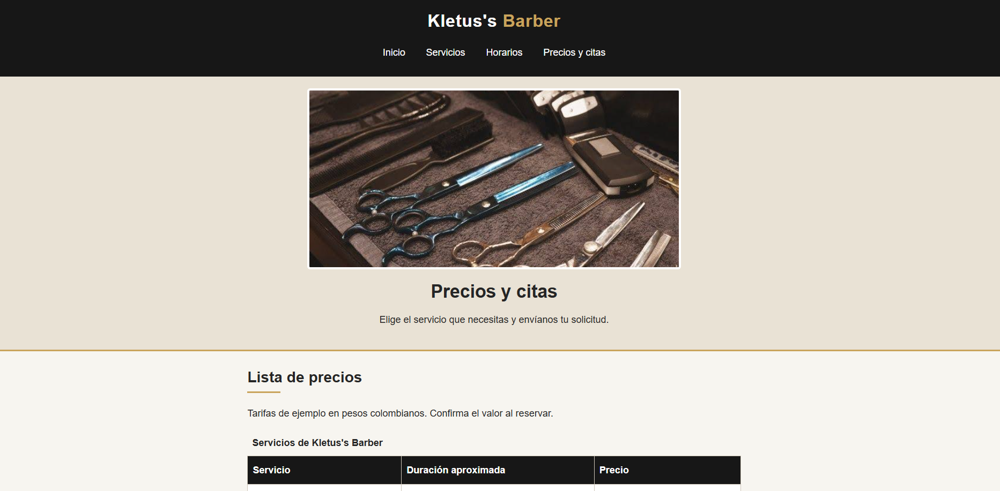

# Kletus's Barber

## 1. El proyecto

Kletus's Barber es una barbería ficticia creada como ejercicio de HTML y CSS. El sitio está pensado para personas que quieren conocer los servicios, revisar precios y solicitar una cita. La información comercial y las tarifas son de ejemplo ya que no es real, se bisca solventar la necesidad del dueño de la barberia para agendar citas por internet y hacer mas visible el negocio en la web.

## 2. Estructura

```text
Kletus_Barber/
├── index.html
├── precios.html
├── README.md
├── css/
│   └── styles.css
├── images/
│   └── (fotografías descargadas de internet)
└── capturas/
    └── (capturas solicitadas)
```

`index.html` presenta el negocio y sus servicios. `precios.html` contiene la tabla y el formulario. En ambas páginas se usan `header`, `nav`, `main`, `section` y `footer` para separar las partes del sitio. Los servicios y las opiniones usan `article` porque cada bloque tiene contenido propio. La hoja externa `css/styles.css` mantiene los estilos separados del contenido.

## 3. Sistema visual

Las variables están al inicio de `css/styles.css` dentro de `:root`. `--color-oscuro` se usa para el encabezado y el pie de página; `--color-acento` es un dorado que recuerda el estilo de una barbería; `--color-fondo` ayuda a distinguir las secciones sin usar muchos colores. La fuente es Arial para que el texto sea fácil de leer y no dependa de descargar otra fuente. Se usa `padding` para dejar espacio dentro de las secciones y `max-width` para que los párrafos no queden demasiado largos en pantallas grandes. Los colores usados fueron sencillos y no se busco una gama amplia ya que la idea era que quedara sobrio y elegante.

## 4. Especificidad

La especificidad se escribe como **(IDs, clases/pseudoclases, etiquetas/pseudoelementos)**. Los tres ejemplos siguientes corresponden a reglas presentes en `css/styles.css`; las capturas se tomaron después de abrir la página en el navegador y seleccionar el elemento indicado.

### Conflicto 1: Enlaces del menú

- `a` → **(0, 0, 1)**. Establece el color general de los enlaces.
- `.navegacion__enlace` → **(0, 1, 0)**. Establece el color de los enlaces del menú.
- Gana `.navegacion__enlace` porque una clase tiene mayor especificidad que una etiqueta.
- Captura: `capturas/especificidad-1.png`.



### Conflicto 2: Texto de la tarjeta destacada

- `.servicio p` → **(0, 1, 1)**. Establece el color general de los párrafos de una tarjeta.
- `.servicio--destacado .servicio__texto` → **(0, 2, 0)**. Establece el color y el grosor del texto de la tarjeta destacada.
- Gana `.servicio--destacado .servicio__texto` porque tiene dos clases, mientras que la otra regla tiene una clase y una etiqueta.
- Captura: `capturas/especificidad-2.png`.



### Conflicto 3: Campo del formulario enfocado

- `.formulario input` → **(0, 1, 1)**. Regla general de campos de entrada dentro del formulario.
- `.formulario__campo:focus` → **(0, 2, 0)**. Se aplica cuando el campo tiene el foco y cambia el borde y el fondo.
- Gana `.formulario__campo:focus` porque tiene una clase y una pseudoclase, frente a una clase y una etiqueta.
- Captura: `capturas/especificidad-3.png`.



**Conflicto 4: empate de especificidad y orden de las reglas**

- `.navegacion__enlace:hover` → **(0, 2, 0)**. Cambia el color del enlace cuando el puntero está encima.
- `.navegacion__enlace:focus-visible` → **(0, 2, 0)**. Cambia el color del enlace cuando recibe el foco mediante el teclado.
- Ambos selectores tienen la misma especificidad y declaran las propiedades `color` y `text-decoration`. Cuando los dos estados se aplican simultáneamente, prevalece la regla que aparece más abajo en el archivo CSS.



## 5. Herencia

La propiedad `color` se hereda normalmente: el color blanco declarado en `.encabezado` llega al texto de la navegación, salvo que una regla más específica cambie el color del enlace. En cambio, `border` no se hereda: el borde de `.servicio` solo aparece alrededor de la tarjeta y no pasa automáticamente a sus párrafos o imágenes.

## 6. Modelo de cajas

En `.formulario`, el ancho máximo es de 620 px y el `padding` es de 18 px a cada lado, además de un borde de 1 px. Con el modelo `border-box` declarado mediante `* { box-sizing: border-box; }`, el ancho total de la caja no supera los 620 px: el padding y el borde se incluyen dentro del ancho. Sin `border-box`, habría que sumar el padding y los bordes al ancho del contenido. Los márgenes verticales de elementos consecutivos pueden colapsar en CSS normal; en este proyecto se puede observar, por ejemplo, entre bloques de párrafo dentro de una sección.

## 7. Selectores

El selector `.servicio:nth-child(odd)` selecciona los elementos `.servicio` que ocupan una posición impar entre los hijos de su elemento padre. La cuenta incluye todos los elementos hermanos, no solo los que tengan la clase `servicio`; por eso se debe revisar la estructura HTML antes de predecir qué tarjeta coincide. También se usa el selector de atributo `.formulario input[required]` para destacar los campos obligatorios, el combinador `.formulario__grupo label` para seleccionar etiquetas dentro de cada grupo y `h2::after` para dibujar una línea decorativa después de los títulos.

## 8. Responsive

La regla `@media (max-width: 600px)` cambia el menú a una lista vertical, reduce el tamaño de los títulos y compacta las celdas de la tabla. Las imágenes y los campos usan `width: 100%` y `max-width` para adaptarse al ancho disponible. Se debe probar la página en 360 px de ancho y comprobar que no aparezca desplazamiento horizontal.

## 9. Problemas y soluciones

1. **La tabla puede quedar apretada en un celular.** La regla responsive reduce el padding y el tamaño del texto de las celdas y permite que las palabras largas se ajusten.
2. **El formulario no envía correos automáticamente.** El atributo `action="#confirmacion"` sirve para demostrar la estructura del formulario en este ejercicio; para recibir solicitudes reales se necesitaría un servicio de backend o de formularios, es decir el boton realmente no envia nada.

## 10. Capturas

En esta seccion se muestran las capturas solicitadas por el taller, vista del index del escritotio y vista de un movil, asi como la vista de la pagina de precios y su respectiva vista desde movil.

### Vista de escritorio del Index


### Vista móvil a 360 px del Index


### Vista de escritorio de Precios



### Vista móvil a 360 px de Precios


### Inspector de especificidad

Guarda las capturas como `capturas/conflicto-1-especificidad.png`, `capturas/conflicto-2-especificidad.png` y `capturas/conflicto-3-especificidad.png`. En cada una, selecciona el elemento indicado en la sección 4 y comprueba que las reglas mostradas coincidan con el cálculo escrito aquí.


